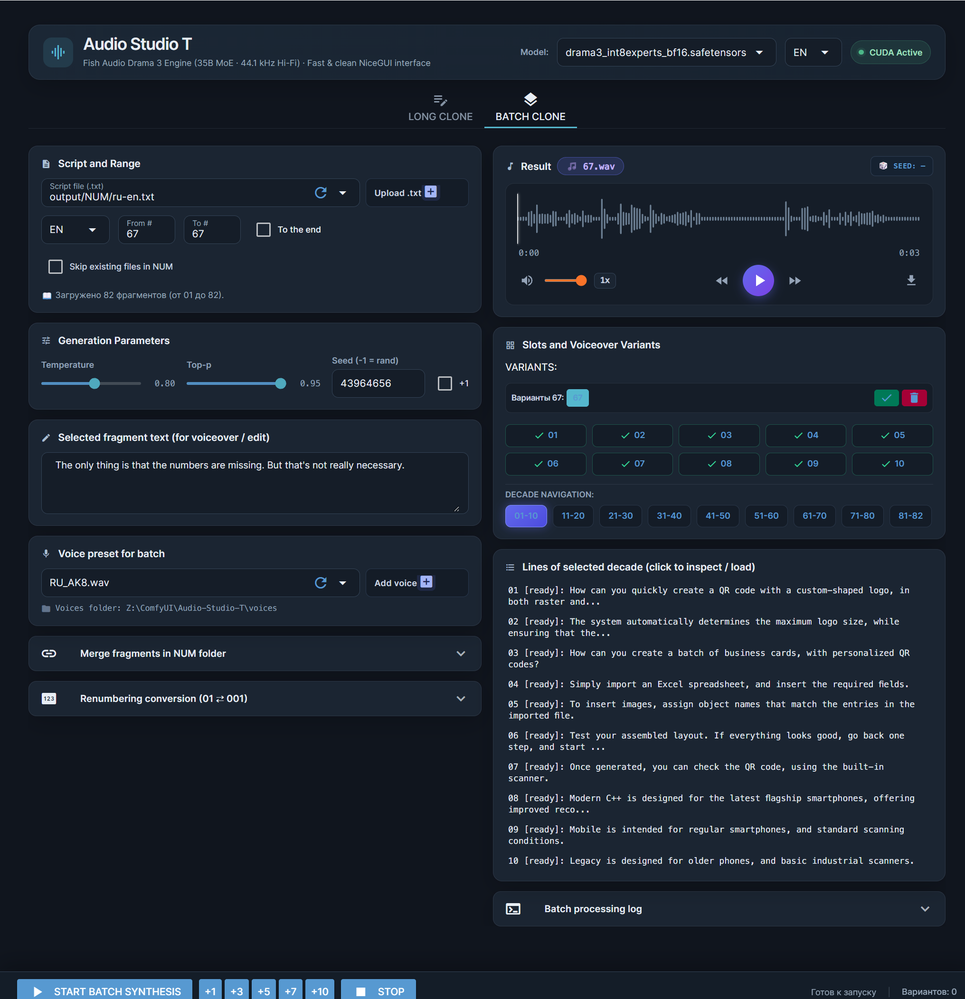
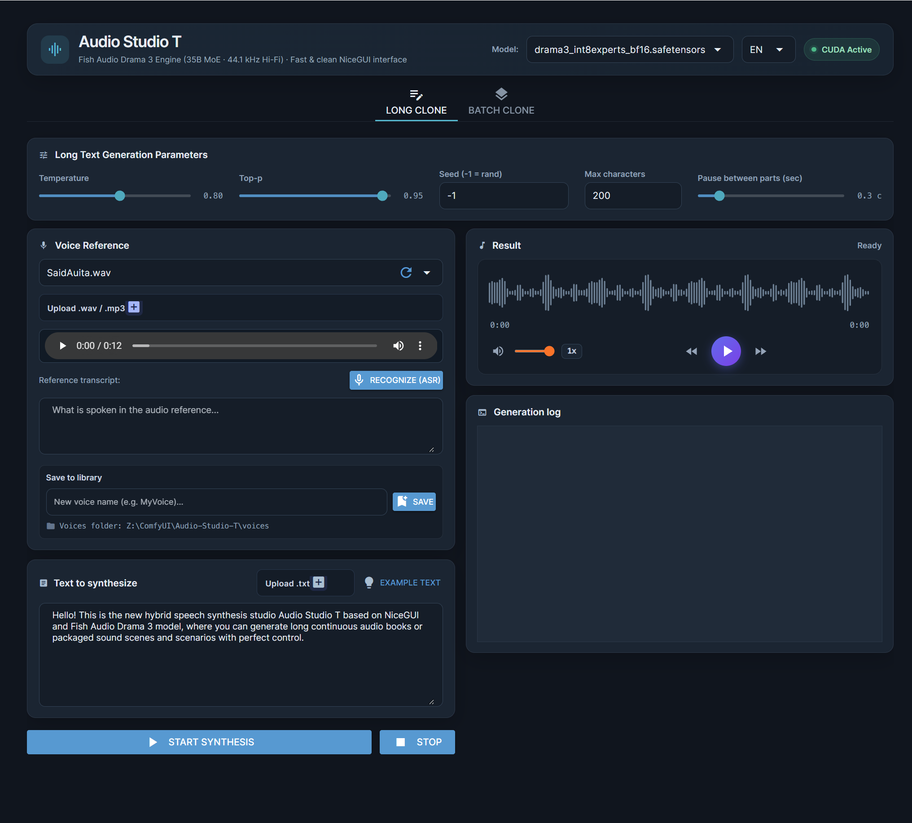
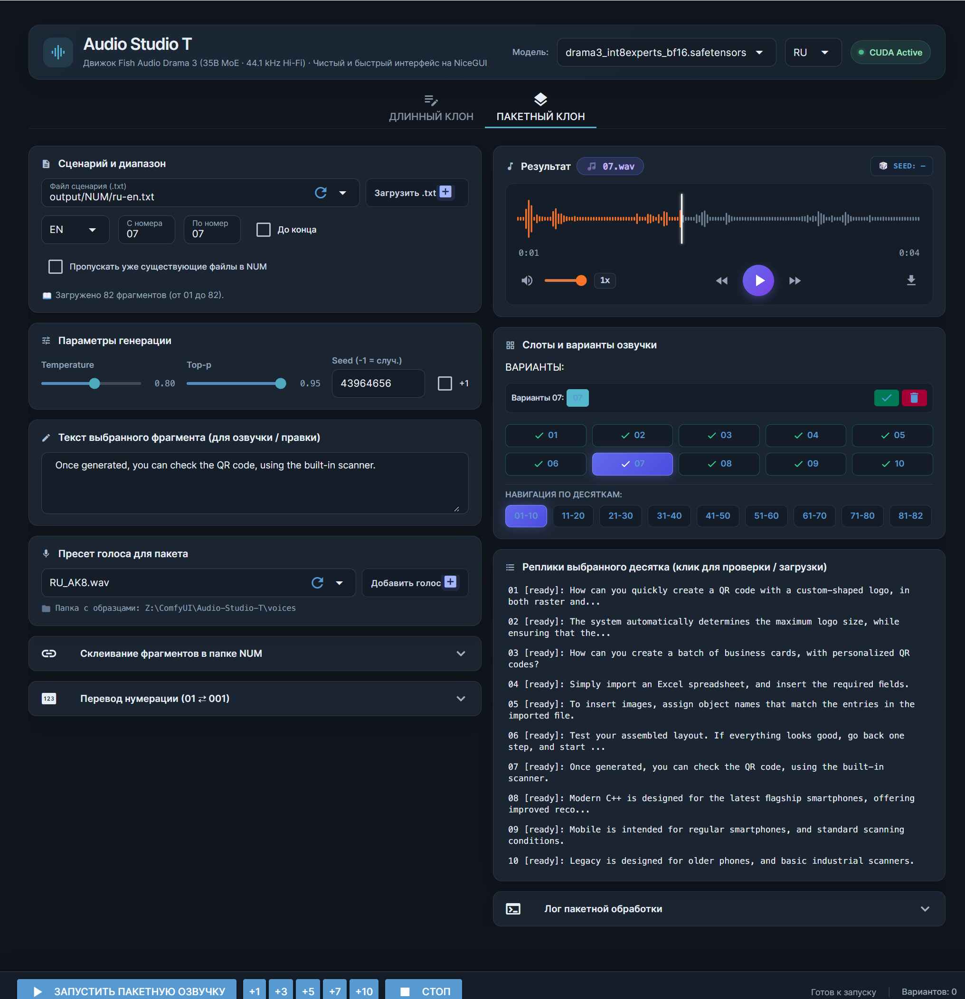
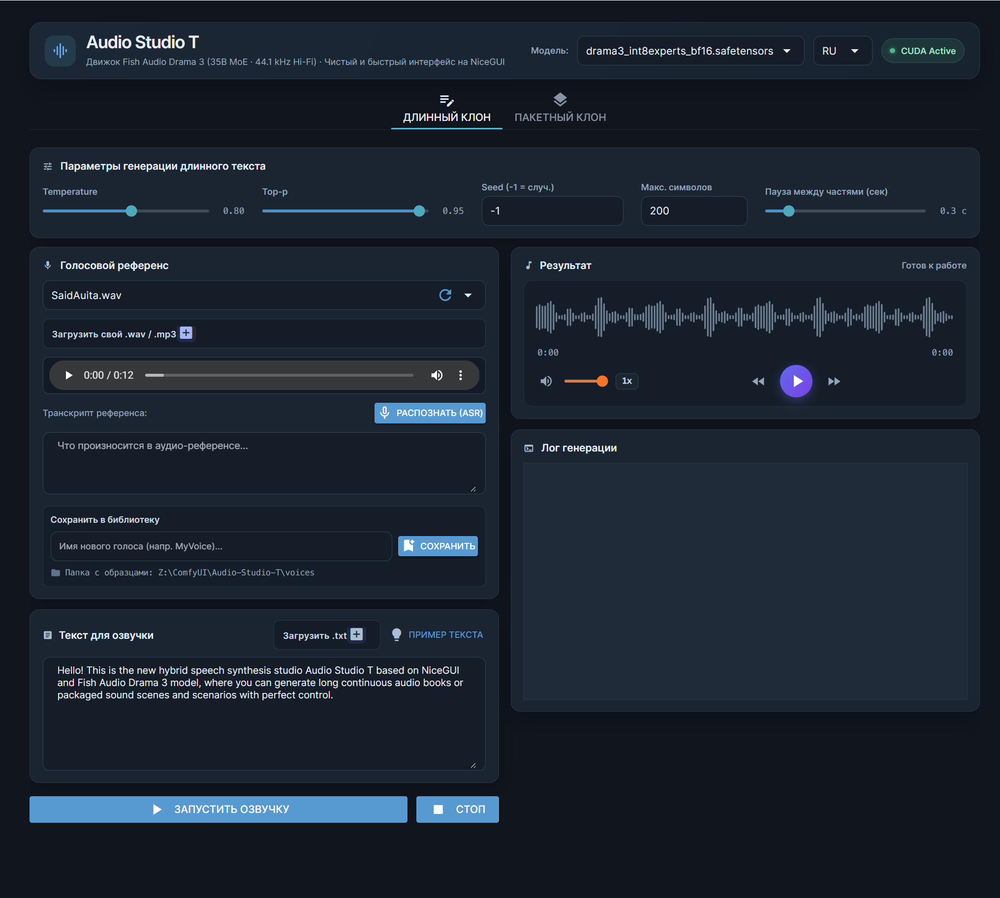

# 🎙️ Audio Studio T

<div align="center">

**Next-Gen Speech Synthesis & Voice Cloning Studio**  
*Powered by Fish Audio Drama 3 (35B MoE · 44.1 kHz Hi-Fi) + Qwen3-ASR & NiceGUI*

[](https://www.python.org/)
[](https://developer.nvidia.com/cuda-toolkit)
[-purple.svg)](https://nicegui.io/)
[](https://github.com/fishaudio)
[](LICENSE)

[English](#english) | [Русский](#russian)

</div>

---

<a name="english"></a>
## 🌐 English

**Audio Studio T** is a high-performance speech synthesis and voice cloning workstation. It combines the cutting-edge **Fish Audio Drama 3** (35B Mixture-of-Experts, 44.1 kHz Hi-Fi) model and **Qwen3-ASR** speech recognition with a sleek, reactive **Dark Studio** interface built on **NiceGUI** (FastAPI + Vue 3 + Tailwind CSS).

---

### 📸 Interface Preview

<div align="center">

#### 🧬 Long Clone (Longform Audio & Books)


#### 🧬 Batch Clone (Script-Driven Production)


</div>

---

### ✨ Key Features

#### 1. 🧬 Longform Voice Cloning (Long Clone)
* **Smart Sentence Chunking**: Automatically splits books, articles, or large texts into natural sentence segments respecting the configured character limit (`Max chars`).
* **Text File (.txt) Upload**: Direct upload of `.txt` files with auto-detection of UTF-8 (with or without BOM) and Windows CP-1251 encodings.
* **Integrated Qwen3-ASR**: Instant one-click automatic speech recognition of voice references with zero external dependencies.
* **Voice Library Management**: Save any uploaded voice sample along with its transcript into the library (`voices/`) with custom naming. Saved voices become immediately accessible across both modes.
* **Interactive Waveform Player**: Real-time audio waveform visualization, scrubbing, speed control (0.5x – 2.0x), and volume control.
* **Continuous Autoregressive Chaining**: Sequential generation with automatic seed progression (`seed + i`), seamless concatenation, customizable inter-segment pauses, and LUFS loudness normalization.

#### 2. 🧬 Script-Driven Production (Batch Clone)
* **Structured Script Workflow**: Native support for dialogue and script files (`output/NUM/ru-en.txt`) with decade-based navigation (`01–10`, `11–20`, etc.).
* **10 Interactive Slots**: Quick status indicators displaying synthesized, approved, and pending lines.
* **Variant Generation**: Generate multiple takes with one click (`+1`, `+3`, `+5`, `+7`, `+10`).
* **Seed `+1` Mode**: Increment seed by 1 for each generated variant for systematic variation testing.
* **One-Click Approval & Cleanup**: Approve the best take into the project while automatically cleaning up temporary files.
* **Batch Stitcher & Numbering Converter**: Merge numbered ranges into a single master WAV and convert between 2-digit (`01`) and 3-digit (`001`) numbering formats.

#### 3. 🛠️ Modern Architecture & Performance
* **Bilingual UI (EN / RU)**: Switch interface language on the fly right in the header bar.
* **Fully Standalone**: Decoupled from external project dependencies with its own local `models/` repository and embedded Python runtime.
* **Memory-Optimized MoE**: Employs int8-quantized experts stored in system RAM with dynamic VRAM caching, enabling high-fidelity 35B MoE synthesis even on consumer GPUs (RTX 3090 / 4090 / etc.).

---

### 📁 Project Structure

```text
Audio-Studio-T/
├── app.py                   # Main NiceGUI application & UI layout
├── engine.py                # Synthesis engine & JSON-RPC client
├── drama_worker.py          # Dedicated inference worker (Drama 3 & Qwen3-ASR)
├── batch_utils.py           # Audio stitching, voice scanning & numbering utilities
├── waveform_player.py       # Custom Vue 3 / Wavesurfer waveform component
├── dark-studio.css          # Studio Dark Theme stylesheet
├── lang.json                # Bilingual dictionary (EN / RU)
├── requirements.txt         # Python package dependencies
├── install.bat              # Automated installer (Python, CUDA PyTorch & packages)
├── run.bat                  # One-click startup script for Windows
├── images/                  # UI screenshots (EN / RU)
├── models/                  # Self-contained models
│   ├── diffusion_models/    # drama3_int8experts_bf16.safetensors
│   ├── vae/                 # drama3_codec.safetensors
│   └── asr/                 # qwen3_asr_0.6b_bf16.safetensors
├── voices/                  # Voice library (.wav / .mp3 + .txt transcripts)
└── output/                  # Generated audiobooks, takes, and master WAVs
```

---

### 🚀 Getting Started

#### Prerequisites
* Windows 10 / 11 (64-bit)
* NVIDIA GPU with 16 GB+ VRAM (RTX 3090, 4080, 4090 recommended)
* CUDA 12.8 / 13.0 with `cu130` PyTorch

#### Installation & Launch
1. **Automated Setup**:
   Run `install.bat` to automatically set up an isolated Python environment, install CUDA-enabled PyTorch, and all dependencies.
2. **Launch**:
   Double-click **`run.bat`** or launch via terminal:
   ```cmd
   python\python.exe app.py
   ```
   Open your web browser at: **`http://127.0.0.1:7860`**

---

<a name="russian"></a>
## 🇷🇺 Русский

**Audio Studio T** — современная профессиональная гибридная студия синтеза речи и клонирования голоса. Система объединяет передовую модель **Fish Audio Drama 3** (35B Mixture-of-Experts, 44.1 кГц Hi-Fi), распознавание речи **Qwen3-ASR** и эргономичный интерфейс в стиле **Dark Studio** на базе **NiceGUI** (FastAPI + Vue 3 + Tailwind CSS).

---

### 📸 Интерфейс приложения

<div align="center">

#### 🧬 Длинный клон (Озвучивание книг и статей)


#### 🧬 Пакетный клон (Сценарная пакетная озвучка)


</div>

---

### ✨ Возможности и преимущества

#### 1. 🧬 Длинный клон (Long Clone)
* **Интеллектуальная нарезка текста**: Автоматическое разделение книг, статей и длинных текстов по абзацам и знакам препинания с соблюдением порога символов (`Макс. символов`).
* **Загрузка текстовых файлов (.txt)**: Прямая загрузка файлов `.txt` с автоопределением кодировок UTF-8 (с BOM и без) и Windows CP-1251.
* **Встроенный Qwen3-ASR**: Моментальное распознавание текста с голосового референса в один клик без сторонних API.
* **Сохранение в библиотеку голосов**: Загруженный голос вместе с текстом-транскриптом сохраняется в папку библиотеки `voices/` под выбранным именем и сразу доступен в обоих режимах работы.
* **Интерактивный Waveform-плеер**: Визуализация звуковой волны в реальном времени, быстрая перемотка по клику, регулировка скорости воспроизведения (0.5x – 2.0x) и громкости.
* **Бесшовная склейка**: Последовательная генерация с инкрементом сида (`seed + i`), выравнивание громкости по стандарту LUFS и объединение фрагментов с настраиваемой паузой.

#### 2. 🧬 Пакетный клон (Batch Clone)
* **Сценарный конвейер**: Работа со структурированными сценариями (`output/NUM/ru-en.txt`) и быстрая навигация по десяткам (`01–10`, `11–20`...).
* **10 интерактивных слотов**: Наглядные индикаторы статуса для каждой реплики сцены.
* **Генерация вариантов**: Создание серии дублей в один клик (`+1`, `+3`, `+5`, `+7`, `+10`).
* **Режим Seed `+1`**: Чекбокс для пошагового смещения сида на +1 для каждого последующего варианта.
* **Утверждение дубля**: Выбор лучшего дубля в проект с автоматической очисткой временных файлов.
* **Склеивание и перенумерация**: Объединение диапазона реплик в единый master-файл и конвертация нумерации `01 ⇄ 001`.

#### 3. 🛠️ Архитектура и автономность
* **Двуязычный интерфейс (RU / EN)**: Моментальное переключение языка интерфейса в шапке приложения.
* **Полная автономность**: Проект полностью отвязан от внешних папок, использует собственное изолированное окружение Python и хранит модели внутри папки `models/`.
* **Эффективное распределение памяти**: Эксперты модели Drama 3 (int8) размещаются в оперативной памяти (RAM) с динамической подкачкой в кеш видеопамяти (VRAM), что даёт высокое качество 35B MoE даже на обычных видеокартах с 24 ГБ VRAM (RTX 3090 / 4090).

---

### 🚀 Быстрый старт

#### Требования
* Windows 10 / 11 (64-bit)
* Видеокарта NVIDIA с 16+ ГБ VRAM (рекомендуется RTX 3090, 4080, 4090)
* Драйверы с поддержкой CUDA 12.8 / 13.0 (cu130 PyTorch)

#### Установка и запуск
1. **Автоматическая установка**:
   Запустите файл **`install.bat`** — скрипт сам загрузит изолированный Python 3.12, установит PyTorch с выбранной версией CUDA и все необходимые библиотеки.
2. **Запуск**:
   Запустите файл **`run.bat`** или выполните в консоли:
   ```cmd
   python\python.exe app.py
   ```
   Откройте браузер по адресу: **`http://127.0.0.1:7860`**

---

### 📜 Лицензия и благодарности
* Движок синтеза: [Fish Audio Drama 3](https://github.com/fishaudio)
* Интерфейс: [NiceGUI](https://nicegui.io/)
* Распознавание речи: [Qwen3-ASR](https://github.com/QwenLM)
* Лицензия: Apache-2.0
